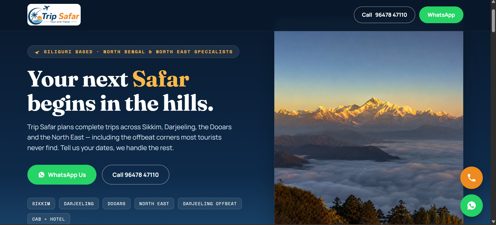
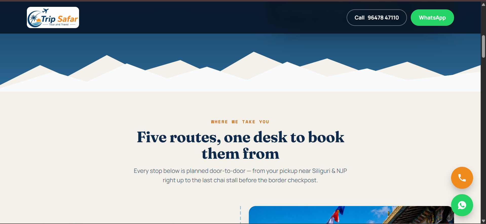
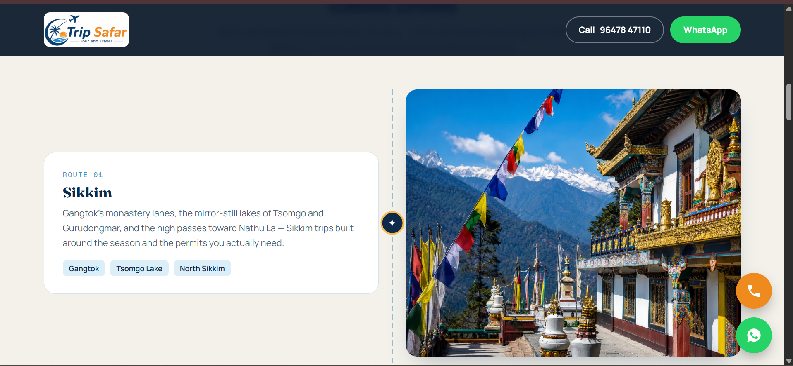
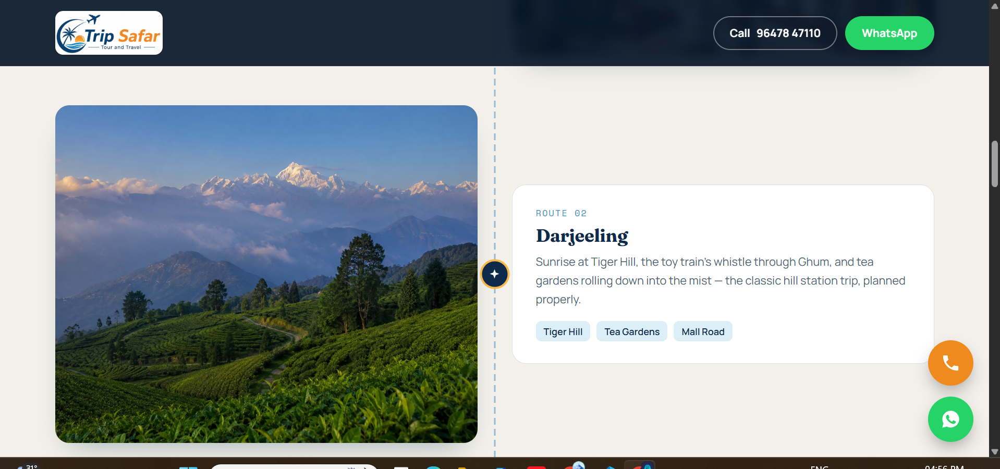
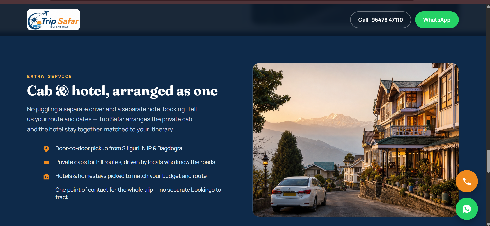
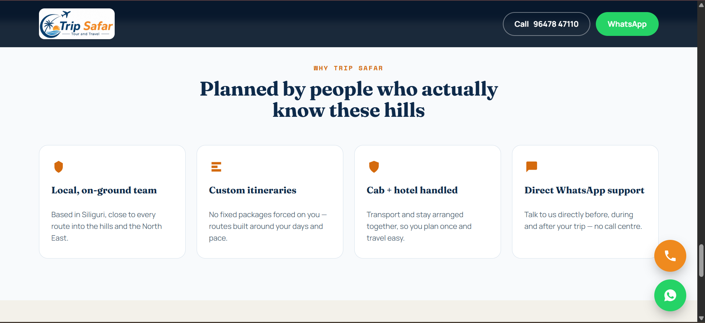
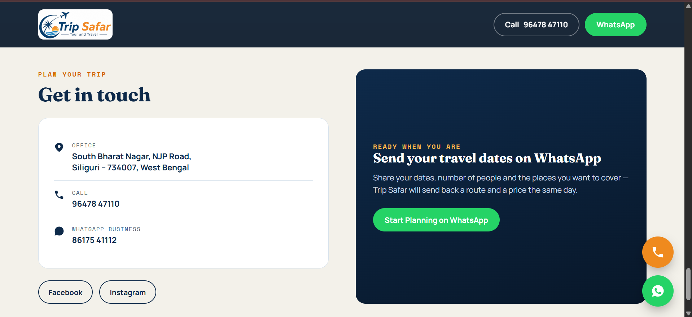

# Trip-Safar-Tour-Travel-Landing-Page-Case-Study
# Trip Safar Tour & Travel Landing Page Case Study

Client landing page case study for Trip Safar Tour and Travel, a Siliguri-based travel agency website with destination route sections, cab and hotel service presentation, WhatsApp-first enquiry flow, responsive design, and live deployment.

## Overview

This is a client landing page case study for Trip Safar Tour and Travel, a tour and travel business based in Siliguri, West Bengal. The landing page was built to create a strong online presence, showcase the agency's travel routes across Sikkim, Darjeeling, Dooars, North East and offbeat Darjeeling, present the combined cab and hotel service, and help travellers connect directly through WhatsApp and phone calls.

## Live Website

Add live website link here

## Project Type

Client Landing Page Development

## Business Category

Tour & Travel / Holiday Packages / Cab & Hotel Booking

## Key Features

* Travel-themed hero section with mountain ridge design
* Sticky top bar with Call and WhatsApp buttons
* Destination route timeline (journey rail) layout
* Sikkim tour section
* Darjeeling tour section
* Dooars jungle safari section
* North East tour section
* Darjeeling offbeat section
* Cab & hotel combined service section
* "Why Trip Safar" highlights section
* WhatsApp enquiry call-to-action
* Click-to-call phone integration
* Floating WhatsApp and Call buttons
* Contact section with office address and social links
* Responsive landing page layout
* Reduced-motion accessibility support
* Live website deployment

## Tech Stack

* HTML
* CSS
* JavaScript
* Google Fonts
* WhatsApp Click-to-Chat Integration
* Responsive Web Design
* Live Server Deployment
* Claude-assisted development
* ChatGPT-assisted development

## My Role

I worked on the landing page structure, page layout, content placement, responsive design, destination and service presentation, WhatsApp and call enquiry flow, and deployment support. I used Claude and ChatGPT to assist in building and improving the landing page for a real client project.

## Screenshots

### Hero Section

### Destinations Section

### Cab & Hotel Service Section

### Why Trip Safar Section

### Contact Section

## Status

Completed and live.

## Confidentiality Note

This repository is a portfolio case study. Sensitive client data, hosting credentials, business enquiries, customer details, and private source code are not included.
